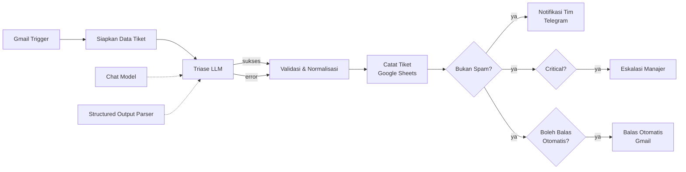
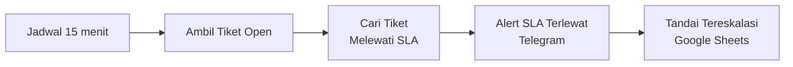

# Intelligent Email & Ticket Triage dengan n8n

Sistem triase tiket dukungan pelanggan otomatis. Setiap email yang masuk ke Gmail dianalisis oleh LLM (kategori, urgensi, sentimen, bahasa, ringkasan, dan draf balasan), dicatat sebagai tiket di Google Sheets, diteruskan ke tim yang tepat lewat Telegram, dieskalasi ke manajer bila kritis, dan dibalas dengan konfirmasi otomatis. Workflow kedua memantau **SLA** dan mengeskalasi tiket yang terlambat ditangani.

Seluruh sistem dibangun sebagai satu workflow **n8n** tanpa backend kustom.

---

## Daftar Isi

- [Fitur Utama](#fitur-utama)
- [Arsitektur](#arsitektur)
- [Teknologi yang Digunakan](#teknologi-yang-digunakan)
- [Struktur Repository](#struktur-repository)
- [Prasyarat](#prasyarat)
- [Instalasi](#instalasi)
- [Konfigurasi Workflow](#konfigurasi-workflow)
- [Cara Penggunaan dan Pengujian](#cara-penggunaan-dan-pengujian)
- [Penjelasan Detail Workflow](#penjelasan-detail-workflow)
- [Keputusan Desain](#keputusan-desain)
- [Keamanan dan Privasi](#keamanan-dan-privasi)
- [Troubleshooting](#troubleshooting)
- [Keterbatasan](#keterbatasan)
- [Rencana Pengembangan](#rencana-pengembangan)
- [Lisensi](#lisensi)

---

## Fitur Utama

| Fitur | Keterangan |
|---|---|
| **Klasifikasi terstruktur** | LLM mengembalikan JSON sesuai skema (enum kategori, urgensi, sentimen, bahasa) lewat *Structured Output Parser*. |
| **Validasi dan fallback** | Output LLM divalidasi ulang di Code node. Jika LLM gagal atau *confidence* rendah, tiket dialihkan ke antrean **Triase Manual**, bukan hilang. |
| **Routing otomatis** | Tiap kategori diarahkan ke chat tim yang berbeda (Teknis, Finance, Sales, Customer Success, Produk). |
| **Penanganan spam** | Email spam dicatat dengan status `spam`, tanpa notifikasi dan tanpa balasan. |
| **Eskalasi kritis** | Tiket berurgensi `critical` langsung diteruskan ke manajer. |
| **Draf balasan** | LLM menyiapkan draf balasan dalam bahasa pengirim, ditampilkan ke tim sebagai bantuan (tidak dikirim otomatis). |
| **Balasan konfirmasi otomatis** | Pengirim menerima konfirmasi bernomor tiket (template, bukan buatan LLM). Alamat `noreply` dan spam dilewati. |
| **Monitor SLA** | Setiap 15 menit, tiket `open` yang melewati batas SLA dieskalasi sekali ke manajer. |
| **Retry dan penanganan error** | Pemanggilan LLM dicoba ulang, dan kegagalan tetap menghasilkan tiket (status `fallback`). |

---

## Arsitektur

### Alur 1: Intake dan Triase



### Alur 2: Monitor SLA



### Batas SLA default

| Urgensi | SLA |
|---|---|
| critical | 1 jam |
| high | 4 jam |
| medium | 24 jam |
| low | 72 jam |

---

## Teknologi yang Digunakan

| Komponen | Fungsi |
|---|---|
| [n8n](https://n8n.io) | Orkestrasi workflow |
| Gmail API | Sumber email dan pengiriman balasan |
| OpenAI `gpt-4o-mini` | Klasifikasi (temperature 0) |
| Google Sheets | Basis data tiket |
| Telegram Bot API | Notifikasi tim dan eskalasi |

Model dapat diganti di node **Chat Model**. Telegram dapat diganti Slack atau Discord dengan mengganti node notifikasi.

---

## Struktur Repository

```
.
├── README.md
├── email_ticket_triage.json     # workflow n8n siap import
└── tickets_template.csv         # header kolom untuk Google Sheet
```

---

## Prasyarat

- Instance n8n (self-hosted atau cloud)
- Akun Google (Gmail dan Google Sheets) dengan OAuth di Google Cloud Console
- API key OpenAI
- Bot Telegram dari [@BotFather](https://t.me/BotFather) dan grup atau chat untuk tiap tim

---

## Instalasi

### 1. Siapkan Google Sheet

1. Buat spreadsheet baru dan beri nama sheet (tab) **`Tickets`**.
2. Impor `tickets_template.csv` ke sheet tersebut, atau salin baris header berikut ke baris 1:

```
ticket_id, received_at, sender_email, sender_name, subject, category, urgency, sentiment, language,
summary, suggested_reply, confidence, assigned_team, sla_due, status, triage_status, thread_id,
escalated, escalated_at
```

3. Catat **Spreadsheet ID** dari URL (`docs.google.com/spreadsheets/d/<ID>/edit`).

Nama kolom harus persis sama, karena workflow memetakan data berdasarkan nama kolom.

### 2. Siapkan bot dan chat Telegram

1. Buat bot lewat [@BotFather](https://t.me/BotFather) dan simpan tokennya.
2. Buat grup untuk tiap tim (Teknis, Finance, Sales, Customer Success, Produk), satu grup Triase Manual, dan satu chat Manajer. Anda boleh memakai satu chat yang sama untuk semuanya saat uji coba.
3. Tambahkan bot ke setiap grup dan kirim satu pesan di grup tersebut.
4. Dapatkan chat ID grup, misalnya lewat [@RawDataBot](https://t.me/RawDataBot) atau dari endpoint `getUpdates`. Chat ID grup biasanya berupa angka negatif.

### 3. Siapkan OAuth Google

1. Di [Google Cloud Console](https://console.cloud.google.com), aktifkan **Gmail API** dan **Google Sheets API**.
2. Konfigurasikan OAuth consent screen dan buat **OAuth Client ID** bertipe *Web application*.
3. Salin Redirect URI dari form credential di n8n ke *Authorized redirect URIs*.
4. Buat credential **Gmail OAuth2** dan **Google Sheets OAuth2** di n8n lalu login dengan akun Google.

### 4. Buat credentials lainnya di n8n

| Credential | Isian utama |
|---|---|
| OpenAI API | API key |
| Telegram API | Token bot |

### 5. Import workflow

1. Di n8n pilih **Workflows → Import from File** dan pilih `email_ticket_triage.json`.
2. Hubungkan setiap node dengan credential yang sesuai.
3. Lanjutkan ke bagian konfigurasi.

---

## Konfigurasi Workflow

| Lokasi | Placeholder | Isi dengan |
|---|---|---|
| Node **Validasi & Normalisasi** (bagian atas kode) | `GANTI_CHAT_ID_TEKNIS`, `..._FINANCE`, `..._SALES`, `..._CS`, `..._PRODUK`, `..._TRIASE`, `GANTI_CHAT_ID_MANAJER` | Chat ID Telegram tiap tim dan manajer |
| Node **Cari Tiket Melewati SLA** (bagian atas kode) | `GANTI_CHAT_ID_MANAJER` | Chat ID manajer (sama dengan di atas) |
| Node **Catat Tiket**, **Ambil Tiket Open**, **Tandai Tereskalasi** | `GANTI_DENGAN_SPREADSHEET_ID` | Spreadsheet ID (ada di tiga node) |
| Semua node ber-credential | `GANTI_ID` | Pilih credential yang sudah dibuat |

Parameter yang bisa disesuaikan di node **Validasi & Normalisasi**:

| Konstanta | Default | Fungsi |
|---|---|---|
| `SLA_HOURS` | critical 1, high 4, medium 24, low 72 | Batas SLA per urgensi (jam) |
| `MIN_CONFIDENCE` | `0.6` | Di bawah nilai ini tiket masuk Triase Manual |
| `TEAMS` | lihat kode | Pemetaan kategori ke nama tim dan chat |

Parameter lain: kategori dan urgensi didefinisikan di system prompt node **Triase LLM** dan di skema **Structured Output Parser**. Jika Anda menambah kategori, ubah ketiga tempat (prompt, skema, dan konstanta `TEAMS` beserta daftar `pick` di Code node).

Terakhir, aktifkan workflow dengan tombol **Active**.

---

## Cara Penggunaan dan Pengujian

Kirim email uji ke alamat Gmail yang terhubung (dari akun lain), lalu tunggu hingga satu menit.

| Email uji | Hasil yang diharapkan |
|---|---|
| "Aplikasi tidak bisa login sejak pagi, seluruh tim kami tidak bisa bekerja." | `technical_support`, urgensi `high` atau `critical`, ke Tim Teknis |
| "Invoice bulan ini terbit dua kali, mohon dicek." | `billing`, ke Tim Finance |
| "Boleh minta penawaran paket untuk 50 pengguna?" | `sales_inquiry`, ke Tim Sales |
| "Dapatkan diskon 90% hanya hari ini, klik tautan ini!" | `spam`, hanya dicatat, tanpa notifikasi |
| "halo" | Confidence rendah, masuk Triase Manual dengan peringatan |

Setelah tiket ditangani, ubah kolom `status` di Sheet menjadi `closed`. Tiket `closed` tidak lagi dipantau SLA.

Untuk menguji monitor SLA tanpa menunggu, ubah nilai `sla_due` suatu tiket `open` ke waktu lampau, lalu jalankan workflow *Jadwal Cek SLA* secara manual.

---

## Penjelasan Detail Workflow

### Alur Intake dan Triase

| Node | Fungsi |
|---|---|
| **Gmail Trigger** | Polling setiap menit untuk email belum dibaca di INBOX (payload penuh agar isi teks tersedia). |
| **Siapkan Data Tiket** | Membuat `ticket_id` (format `TKT-yyyyMMdd-XXXXXX`), mengambil pengirim, subjek, isi (dipotong 4000 karakter), `gmail_id`, dan `thread_id`. |
| **Triase LLM** | Chain LLM dengan system prompt triase dan Structured Output Parser. Retry 2 kali, dan *error output* diarahkan ke langkah validasi agar tidak ada tiket yang hilang. |
| **Chat Model** | OpenAI `gpt-4o-mini`, temperature 0 agar hasil konsisten. |
| **Structured Output Parser** | Skema JSON dengan enum untuk kategori, urgensi, sentimen, dan bahasa. |
| **Validasi & Normalisasi** | Memvalidasi enum, membatasi confidence 0 sampai 1, menentukan tim, menghitung `sla_due`, menyiapkan teks notifikasi dan balasan, serta menandai status `open`, `spam`, atau perlu review. |
| **Catat Tiket** | Menambahkan satu baris ke sheet `Tickets`. |
| **Bukan Spam?** | Memutus alur bagi email spam. |
| **Notifikasi Tim** | Mengirim ringkasan, draf balasan, dan SLA ke chat tim yang sesuai. |
| **Critical?** dan **Eskalasi Manajer** | Mengirim peringatan tambahan ke manajer untuk urgensi kritis. |
| **Boleh Balas Otomatis?** dan **Balas Otomatis** | Membalas konfirmasi di thread email asli, kecuali alamat `noreply` atau spam. |

### Alur Monitor SLA

| Node | Fungsi |
|---|---|
| **Jadwal Cek SLA** | Berjalan setiap 15 menit. |
| **Ambil Tiket Open** | Membaca baris dengan `status = open`. |
| **Cari Tiket Melewati SLA** | Menyaring tiket yang `sla_due` sudah lewat dan belum `escalated`, lalu menyusun teks peringatan. |
| **Alert SLA Terlewat** | Mengirim peringatan ke manajer. |
| **Tandai Tereskalasi** | Mengisi `escalated = yes` dan `escalated_at` agar peringatan tidak berulang. |

### Skema Data Tiket

| Kolom | Contoh | Keterangan |
|---|---|---|
| `ticket_id` | `TKT-20261008-A1B2C3` | ID unik tiket |
| `category` | `billing` | Hasil klasifikasi |
| `urgency` | `high` | `low`, `medium`, `high`, `critical` |
| `sentiment` | `negative` | `positive`, `neutral`, `negative` |
| `confidence` | `0.87` | Keyakinan model (0 sampai 1) |
| `assigned_team` | `Tim Finance` | Hasil routing |
| `sla_due` | `2026-10-08T09:00:00.000Z` | Batas SLA (UTC, ISO 8601) |
| `status` | `open` | `open`, `spam`, atau `closed` (diubah manual) |
| `triage_status` | `ok` | `ok`, `needs_review`, atau `fallback` |
| `escalated` | `yes` | Diisi oleh monitor SLA |

---

## Keputusan Desain

- **LLM hanya mengklasifikasi, aturan bisnis ada di kode.** Penentuan tim, SLA, dan status dilakukan Code node secara deterministik, jadi bisa diuji dan diaudit.
- **Output LLM tidak dipercaya mentah-mentah.** Setiap field divalidasi ulang terhadap daftar nilai yang diizinkan, dengan nilai default yang aman.
- **Gagal tidak berarti hilang.** Jika LLM error, tiket tetap dicatat dengan `triage_status = fallback` dan masuk antrean manual.
- **Balasan otomatis memakai template.** LLM tidak boleh mengirim janji ke pelanggan. Draf buatan LLM hanya dilihat tim internal.
- **Pertahanan terhadap prompt injection.** Isi email diperlakukan sebagai data di system prompt, output dibatasi skema enum, dan tidak ada tool berbahaya yang bisa dipanggil LLM.
- **Pencegahan loop balasan.** Alamat `noreply`, `mailer-daemon`, dan sejenisnya tidak dibalas.

---

## Keamanan dan Privasi

- Jangan commit credentials. File workflow hanya berisi placeholder.
- Isi email dikirim ke OpenAI untuk diklasifikasi. Pastikan ini sesuai kebijakan data organisasi, dan pertimbangkan model self-hosted bila email berisi data sensitif.
- Email dipotong 4000 karakter sebelum dikirim ke LLM, sehingga lampiran dan thread panjang tidak ikut terkirim.
- Batasi akses Google Sheet hanya untuk tim yang berwenang, karena berisi ringkasan dan alamat email pelanggan.
- Hati-hati dengan balasan otomatis pada kotak masuk dengan volume spam tinggi. Pantau eksekusi di minggu pertama.

---

## Troubleshooting

| Gejala | Kemungkinan penyebab dan solusi |
|---|---|
| Tidak ada tiket baru | Workflow belum aktif, email sudah berstatus dibaca (trigger hanya memproses *unread*), atau credential Gmail kedaluwarsa. |
| Semua tiket berstatus `fallback` | Pemanggilan LLM gagal. Periksa API key dan kuota OpenAI, lalu lihat error di tab Executions. |
| Error saat menulis ke Sheet | Nama kolom atau nama tab tidak sama persis dengan template, atau Spreadsheet ID belum diganti. |
| Notifikasi Telegram tidak masuk | Bot belum ditambahkan ke grup, atau chat ID salah. ID grup berupa angka negatif. |
| Balasan otomatis tidak terkirim | Pastikan credential Gmail memiliki izin kirim, dan bahwa pengirim bukan alamat `noreply`. |
| Alert SLA terkirim berulang | Kolom `escalated` tidak terisi. Periksa node *Tandai Tereskalasi* dan kecocokan kolom `ticket_id`. |
| Isi email kosong | Email hanya berformat HTML tanpa bagian teks. Tambahkan fallback ke `textAsHtml` di node *Siapkan Data Tiket*. |
| Node tampil dengan peringatan versi | Versi node n8n Anda berbeda. Buka node, atur ulang parameternya, atau tambahkan ulang node dari panel. |

---

## Keterbatasan

- **Hanya Gmail.** Penyedia email lain memerlukan node trigger yang berbeda (IMAP, Outlook).
- **Polling, bukan real-time.** Ada jeda hingga sekitar satu menit.
- **Balasan pelanggan membuat tiket baru.** Belum ada pelacakan thread untuk menggabungkan ke tiket yang sama.
- **Lampiran tidak dianalisis.** Hanya teks email yang diproses.
- **SLA berjalan 24 jam.** Belum memperhitungkan jam kerja dan hari libur.
- **Google Sheets sebagai database.** Cukup untuk volume kecil sampai menengah, tetapi bukan pengganti sistem tiket penuh.
- **Status `closed` diubah manual.** Belum ada integrasi penutupan tiket otomatis.
- **Belum ada evaluasi otomatis.** Akurasi klasifikasi belum diukur terhadap data berlabel.

---

## Rencana Pengembangan

- [ ] Deduplikasi dan penggabungan balasan ke tiket yang sama berdasarkan `thread_id`
- [ ] SLA dengan jam kerja dan kalender libur
- [ ] Persetujuan manusia lewat tombol Telegram sebelum balasan dikirim (*human-in-the-loop*)
- [ ] Balasan berbasis knowledge base (gabungkan dengan proyek RAG)
- [ ] Pindah penyimpanan ke PostgreSQL atau Airtable
- [ ] Dashboard (Metabase atau Grafana) untuk volume, kategori, dan kepatuhan SLA
- [ ] **Error Trigger workflow** untuk notifikasi kegagalan workflow
- [ ] Ekstraksi lampiran (OCR atau PDF) sebelum klasifikasi
- [ ] Evaluasi akurasi dengan kumpulan email berlabel
- [ ] Refactor menjadi **sub-workflow** (triase, notifikasi, SLA)

---

## Lisensi

Tentukan lisensi sesuai kebutuhan Anda (misalnya MIT) dan tambahkan file `LICENSE` ke repository.

---

## Kontribusi

Issue dan pull request dipersilakan. Untuk perubahan besar, buka issue terlebih dahulu agar rencananya bisa didiskusikan.
